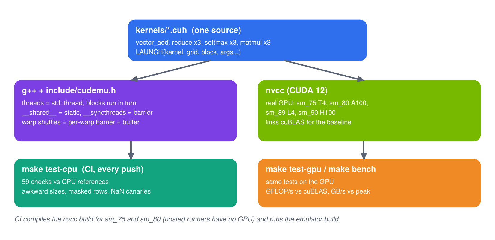

# cuda-kernels

[](https://github.com/tahsin-ts/cuda-kernels/actions/workflows/ci.yml)

CUDA kernels written from scratch, each in three versions that show one optimisation at a time:

| Kernel | v1 | v2 | v3 |
|---|---|---|---|
| Reduction (sum) | shared-memory tree, interleaved | sequential addressing | grid-stride + warp shuffles |
| Softmax (rows) | one thread per row | one block per row | online softmax (one pass for max and sum) |
| Matmul (fp32) | naive | 16x16 shared-memory tiles | 64x64 block tile, 4x4 register tile per thread |

Plus a **CPU emulator** (`include/cudemu.h`): the same kernel source compiles with `g++` and runs
on CPU threads, with real `__syncthreads()` barriers, per-block shared memory and warp shuffles.
That makes correctness testable on any machine and in CI. It is for correctness, not speed.



## Quick start

```bash
make test-cpu          # any Linux/macOS machine with g++ >= 11: runs every kernel on the emulator
make test-gpu          # NVIDIA GPU + CUDA toolkit: the same tests on the GPU
make bench             # GPU timings: GFLOP/s vs cuBLAS, GB/s for memory-bound kernels
make gpu ARCH=sm_80    # pick your GPU: T4 sm_75, A100 sm_80, L4 sm_89, H100 sm_90
```

On Google Colab (free T4): `Runtime > Change runtime type > T4 GPU`, then
`!git clone https://github.com/tahsin-ts/cuda-kernels && cd cuda-kernels && make test-gpu bench`.

## How one source builds two ways

```cpp
LAUNCH(matmul_tiled<16>, grid, block, dA, dB, dC, M, N, K);
// nvcc:  matmul_tiled<16><<<grid, block>>>(dA, dB, dC, M, N, K)
// g++ :  cudemu::launch(grid, block, matmul_tiled<16>, dA, dB, dC, M, N, K)
```

| Emulator feature | How |
|---|---|
| Threads of a block | one `std::thread` each |
| `__shared__` | `static`: blocks run one after another, so it is per-block |
| `__syncthreads()` | `std::barrier` across the block |
| `__shfl_down_sync`, `__shfl_xor_sync` | exchange buffer + one barrier per warp |
| `atomicAdd` | mutex |

The tests catch real bugs: removing a `__syncthreads()` from the tiled matmul, an off-by-one in a
reduction, or a missing `-inf` guard in online softmax all make `make test-cpu` fail.

## Layout

```
include/cudemu.h   CPU emulator          include/launch.h   LAUNCH + CUDA_CHECK
kernels/*.cuh      vector_add, reduce, softmax, matmul
tests/test_kernels.cu   every kernel vs a CPU reference on awkward sizes (59 checks)
bench/bench.cu     GPU benchmark (cudaEvent timing, cuBLAS baseline)
```

## Status

- Correctness: verified on the CPU emulator in CI on every push.
- CUDA build: compiled with `nvcc` 12.4 for sm_75 and sm_80 in CI (hosted runners have no GPU, so it is compiled, not run).
- GPU performance: run `make bench` on your GPU and record the results.

## License

MIT
